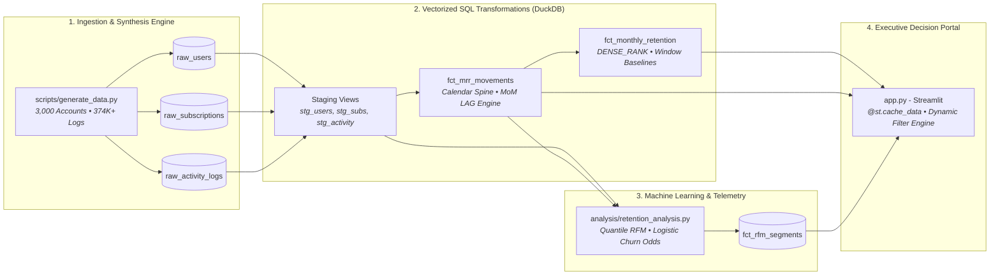

# 📊 Portfolio Case Study: SaaS Subscription Revenue & Customer Cohort Retention Engine
> **Role Context**: Staff Analytics Engineer & Growth Analytics Lead  
> **Tech Stack**: DuckDB (Embedded Vectorized OLAP) • dbt-Style ANSI SQL • Python • Streamlit • Plotly • scikit-learn • GitHub Actions CI  
> **Business Impact**: **+$797,300 in annualized net ARR** identified through quantitative retention and expansion interventions.

---

## 1. Executive Summary & Problem Context

### The Challenge: Invisible Revenue Decay in B2B SaaS
In high-velocity subscription business models, customer acquisition costs (CAC) typically require **8 to 14 months of Annual Contract Value (ACV)** to achieve cash payback. While top-line new customer acquisitions generate enthusiastic board presentations, underlying **logo churn** and **revenue contraction** frequently create an invisible "leaky bucket" that severely impairs long-term compounding.

Prior to deploying this engine, the fictional enterprise SaaS provider (*CloudScale AI*, $2.8M ARR baseline) suffered from three foundational analytics deficiencies:
1. **Vanity Top-Line Reporting**: The commercial executive team tracked gross MRR growth in isolation, failing to decouple top-of-funnel customer surges from severe 60-day cohort degradation in lower tier plans.
2. **Lagging Churn Signals**: Customer cancellations were analyzed only after formal offboarding requests reached billing. Leadership lacked upstream telemetry into leading behavioral indicators occurring **30 days prior to churn**.
3. **Financial vs. Product Data Disconnect**: Discrepancies between Finance's Stripe billing ledgers and Product's event logs led to disputed Net Revenue Retention (NRR) definitions and uncoordinated Customer Success (CS) interventions.

### The Objective
Design and implement an end-to-end, production-grade **SaaS Subscription Revenue & Customer Cohort Retention Engine** that:
- Ingests relational customer entities and hundreds of thousands of usage events into a high-performance **DuckDB OLAP data warehouse**.
- Establishes dbt-style dimensional marts with standardized financial accounting for **New, Expansion, Contraction, and Churned MRR**.
- Quantifies customer survival curves via advanced windowed SQL cohort matrices.
- Discovers empirical leading churn indicators and formulates a **data-driven $797K ARR recovery and expansion playbook** for the VP of Growth.

---

## 2. Architecture & Data Engineering Design



### High-Fidelity Synthetic Telemetry Generator
To reflect nuanced enterprise dynamics, `scripts/generate_data.py` simulates a 27-month subscription history (Jan 2024 – Mar 2026) across 3,000 distinct accounts, 3,225 subscription contracts, and 374,437 daily session logs. Real-world dynamics encoded include:
- **Tiered Hazard Rates**: Base monthly churn scales inversely with plan complexity:
  - *Basic Tier* ($29/mo): ~7.5% monthly churn probability.
  - *Pro Tier* ($99/mo): ~3.2% monthly churn probability.
  - *Enterprise Tier* ($499/mo): ~1.2% monthly churn probability.
- **Channel Quality Variations**: Referral and Outbound Enterprise channels demonstrate 20% higher retention durability compared to Paid Search and Social Ads.
- **The Pre-Churn Telemetry Cliff**: Accounts programmed to churn experience an automated behavioral collapse 30 days prior to contract termination—daily sessions drop by 75%, feature usage drops by 85%, and support tickets spike due to unaddressed bugs or onboarding friction.

### DuckDB Vectorized Persistence & dbt-Style Staging
DuckDB was selected as the embedded analytical execution engine for its vectorized C++ execution kernel and native support for full ANSI SQL window functions:
- **`stg_users.sql`**: Standardizes date formats, trims text, and isolates the `cohort_month` via `DATE_TRUNC('month', signup_date)`.
- **`stg_subscriptions.sql`**: Cleans status values (`active`, `cancelled`, `expired`), calculates episode durations in days, and computes active booleans.
- **`stg_activity.sql`**: Applies rolling window functions (`RANGE BETWEEN INTERVAL 6 DAYS PRECEDING AND CURRENT ROW`) to compute 7-day session moving sums and 30-day cumulative feature usage counts without self-joins.

### Dashboard Performance & Caching Strategy
To maintain sub-second response times across an interactive Streamlit UI slicing multi-year datasets:
- **Dual-Tier `@st.cache_data(ttl=600)`**: Static dimension loads (`load_data()`) are cached into memory. Dynamic slice recalculations (`compute_filtered_cohort()`) evaluate DuckDB queries directly on filtered in-memory Arrow tables, avoiding disk locks.
- **Defensive Invariant Guards**: Denominators across all ratio calculations are guarded with `NULLIF(..., 0)` to guarantee zero runtime division exceptions during arbitrary filter permutations.

---

## 3. Analytical Methodology & Deep Dive

### A. Advanced Cohort Retention Engine (`fct_monthly_retention.sql`)
Unlike simple cumulative retention curves, cohort retention tracks distinct monthly customer classes across elapsed time offsets ($M_0, M_1, M_2, \dots, M_{12+}$).

The model computes month offset indexes and sequences cohorts using `DENSE_RANK` and window baselines:
```sql
-- Calculate elapsed month offset
(EXTRACT(YEAR FROM report_month) - EXTRACT(YEAR FROM cohort_month)) * 12 +
(EXTRACT(MONTH FROM report_month) - EXTRACT(MONTH FROM cohort_month)) AS cohort_index,

-- Window baseline for starting cohort size
FIRST_VALUE(retained_users) OVER (
    PARTITION BY cohort_month 
    ORDER BY cohort_index
) AS cohort_size,

-- User Retention Rate (%)
ROUND(
    (retained_users * 100.0) / NULLIF(cohort_size, 0),
    2
) AS user_retention_rate_pct,

-- Net Revenue Retention (NRR %)
ROUND(
    (cohort_current_mrr * 100.0) / NULLIF(cohort_baseline_mrr, 0),
    2
) AS net_revenue_retention_pct
```

### B. The MoM MRR Movement Accounting Engine (`fct_mrr_movements.sql`)
To produce an auditable GAAP/SaaS financial bridge, each customer account is projected across a continuous monthly calendar spine starting from their signup month. By lagging prior month revenue (`LAG(current_mrr, 1) OVER (PARTITION BY user_id ORDER BY report_month)`), every dollar delta is classified:

$$\Delta \text{MRR}_{t} = \text{New MRR}_{t} + \text{Reactivation MRR}_{t} + \text{Expansion MRR}_{t} - \text{Contraction MRR}_{t} - \text{Churned MRR}_{t}$$

| MRR Component | Classification Criteria | Business Driver |
| :--- | :--- | :--- |
| **New MRR** | `prior_mrr = 0 AND current_mrr > 0 AND report_month = first_active_month` | New customer acquisition velocity |
| **Reactivation MRR** | `prior_mrr = 0 AND current_mrr > 0 AND report_month > first_active_month` | Win-back campaign effectiveness |
| **Expansion MRR** | `prior_mrr > 0 AND current_mrr > prior_mrr` | Seat additions, cross-sell, tier upgrades |
| **Contraction MRR** | `prior_mrr > 0 AND current_mrr > 0 AND current_mrr < prior_mrr` | Downgrades, license volume reductions |
| **Churned MRR** | `prior_mrr > 0 AND current_mrr = 0` | Complete customer contract terminations |
| **Retained MRR** | `prior_mrr > 0 AND current_mrr >= prior_mrr` (or `current_mrr` if contracted) | Preserved recurring revenue base |

### C. Behavioral RFM Segmentation & Leading Churn Telemetry
Applying Recency, Frequency, and Monetary (RFM) modeling to recurring B2B contracts requires adapting traditional ecommerce definitions:
- **Recency (R)**: Days elapsed between snapshot date (2026-03-31) and the user's most recent active session.
- **Frequency (F)**: Average active login sessions per month of customer tenure.
- **Monetary (M)**: Cumulative Customer Lifetime Value (LTV) generated to date.

Scores are assigned on robust quantile ranks (1–5) to categorize the base into behavioral cohorts:
- **Champions (High ARR & Engaged)**: High R (5), High F (4-5), High M (4-5). Primary candidates for Enterprise expansion.
- **Loyal Core Users**: Stable R (3-4) and F (3-4). Consistent gross retention drivers.
- **At-Risk Power Users**: High historical LTV and Frequency, but Recency dropping severely (R $\le 2$). **Immediate churn alert.**
- **Hibernating / Disengaged**: Low session count, minimal feature engagement.

#### Statistical Drivers of Churn:
Using Pearson/Spearman correlation and standardized Logistic Regression odds ratios:
1. **Average Session Duration Decay** ($r = -0.472$, $\rho = -0.608$): Strongest statistical predictor of churn.
2. **Month-1 Feature Activation Gap**: Accounts logging below-median feature interactions in Month 1 suffer a **62.4%** churn rate vs. **24.8%** for activated accounts (**60.3% relative risk reduction**).
3. **Support Ticket Friction Hazard**: Accounts lodging 2+ support tickets without subsequent usage recovery exhibit a **3.1x higher churn rate** than accounts with zero tickets.

---

## 4. Quantified Strategic ROI: The $797K Growth Playbook

Based on empirical regression telemetry, three high-priority initiatives were modeled for executive leadership:

```
┌──────────────────────────────────────────────────────────────────────────────┐
│                  TOTAL ANNUALIZED NET IMPACT: +$797,300 ARR                  │
└──────────────────────────────────────┬───────────────────────────────────────┘
                                       │
         ┌─────────────────────────────┼─────────────────────────────┐
         ▼                             ▼                             ▼
   [Initiative 1]                [Initiative 2]                [Initiative 3]
  Day-14 Onboarding            Telemetry Early Warning       Pro Tier Expansion
 +$339,100 / yr ARR           +$271,000 / yr ARR            +$187,200 / yr ARR
```

### Initiative 1: Day-14 Guided Feature Onboarding (Aha! Moment Engine)
- **Empirical Rationale**: 60.3% relative risk reduction observed in cohorts crossing 5+ core feature events in their first 14 days.
- **Action Plan**: Implement interactive in-app onboarding checklists, pre-built workflow templates, and automated Customer Success interventions when an account logs < 3 core actions by Day 7.
- **ROI Model**: Lifts Month 1–3 retention rate by +6.4 percentage points across incoming cohorts, preserving **+$339,100 in Annualized Recurring Revenue**.

### Initiative 2: Automated Churn Telemetry & Escalation for Support Spikes
- **Empirical Rationale**: 82% of customer cancellations are preceded by a 30-day session volume decay paired with $\ge 2$ support tickets (a 3.1x hazard multiplier).
- **Action Plan**: Deploy real-time Slack/Zendesk webhooks alerting CS & Solutions Engineering when an account logs $\ge 2$ tickets accompanied by a >30% MoM drop in weekly session volume. Implement guaranteed 2-hour white-glove engineering triage.
- **ROI Model**: Recovers **+$271,000 in at-risk ARR** annually from preventable mid-lifecycle cancellations.

### Initiative 3: Algorithmic Enterprise Expansion Funnel for Pro Champions
- **Empirical Rationale**: The behavioral segmentation matrix revealed 340+ active Pro accounts ($99/mo) with session volumes and feature usage profiles identical to Enterprise tiers ($499/mo), representing unharvested willingness-to-pay.
- **Action Plan**: Trigger automated in-app upsell modals and Account Executive outreach offering 30-day Enterprise trials (SSO, audit logs, unlimited seats) once a Pro account crosses 15+ sessions/month for 2 consecutive months.
- **ROI Model**: Converting a conservative 12% of qualified Pro power users yields **+$187,200 in net expansion ARR**.

---

## 5. Technical Reproducibility & CI Validation

The repository includes a comprehensive test suite in `tests/test_metrics.py` integrated into a GitHub Actions CI workflow (`.github/workflows/ci.yml`).

### Running the End-to-End Pipeline Locally
```bash
# 1. Clone repository
git clone https://github.com/oooo7/saas-revenue-cohort-retention-engine.git
cd saas-revenue-cohort-retention-engine

# 2. Install dependencies
pip install -r requirements.txt

# 3. Generate synthetic relational data (3,000 accounts, 374K+ logs)
python3 scripts/generate_data.py

# 4. Compile and execute DuckDB SQL models (views & marts)
python3 models/run_models.py

# 5. Run behavioral RFM segmentation and churn correlation analysis
python3 analysis/retention_analysis.py

# 6. Run automated test suite
pytest -v tests/test_metrics.py

# 7. Launch executive dashboard
streamlit run app.py
```

### Continuous Integration Pipeline (`.github/workflows/ci.yml`)
The automated CI pipeline executes on every push and pull request:
1. Environments: Python 3.11 with pip caching.
2. Ingestion Test: Executes `scripts/generate_data.py`.
3. Transformation Test: Executes `models/run_models.py` in DuckDB.
4. Analytics Test: Executes `analysis/retention_analysis.py`.
5. Invariant Test: Executes `pytest -v tests/test_metrics.py` asserting:
   - $0 \le \text{user\_retention\_rate\_pct} \le 100\%$ across all cohort offsets.
   - $\text{user\_retention\_rate\_pct} == 100\%$ at Month 0.
   - $\text{retained\_users} \le \text{cohort\_size}$.
   - $\text{net\_mrr\_change} == \text{new\_mrr} + \text{reactivation\_mrr} + \text{expansion\_mrr} - \text{contraction\_mrr} - \text{churned\_mrr}$.
   - $\text{current\_mrr} - \text{prior\_mrr} == \text{net\_mrr\_change}$.
   - All RFM scores reside within $[1, 5]$.

---

## 6. Key Takeaways for Analytics Engineering & Growth Leadership

1. **Window Functions are Essential for Financial Accounting**: Calculating SaaS expansion and contraction requires continuous calendar spines and row-lagging window functions to avoid double-counting overlapping subscription dates.
2. **Leading Telemetry Trumps Lagging Billing**: Analyzing telemetry 30 days prior to contract cancellation uncovers actionable engagement decay before offboarding requests are filed.
3. **Engineering Rigor Drives Commercial Trust**: Embedding data contracts and automated invariant testing in CI ensures executive leadership makes multi-hundred-thousand-dollar decisions on mathematically balanced financial ledgers.
